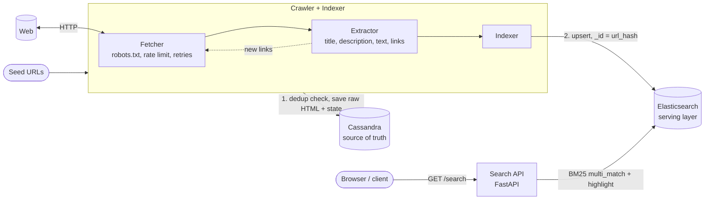

# Search Engine

A modular search engine project consisting of three core components: API, Web Crawler, and Storage.

## Architecture



## Project Structure

```text
search-engine/
├── api/       # FastAPI service + static UI
├── crawler/   # Fetcher, Extractor, Indexer
├── store/     # Cassandra schema, ES mapping, init script
└── README.md
```

## Core Components

- **API:** Handles client requests and exposes search functionality.
- **Crawler:** Fetches web pages and extracts relevant content.
- **Store:** Manages persistence and retrieval of crawled data.

## Getting started

### Prerequisites

- Python 3.10+
- A running Cassandra (default `localhost:9042`)
- A running Elasticsearch 8.x (default `localhost:9200`)

### 1. Initialize storage

Applies the Cassandra schema and creates the Elasticsearch index. Requires `cqlsh`, `curl`, and `python3` on your path.

```bash
./store/init.sh
```

### 2. Run the crawler

```bash
python -m venv .venv && source .venv/bin/activate
pip install -r crawler/requirements.txt

SEED_URLS="https://example.com" \
ALLOWED_DOMAINS="example.com" \
python -m crawler.app.main
```

### 3. Run the Search API

```bash
pip install -r api/requirements.txt
uvicorn api.app.main:app --port 8000
```

Open <http://localhost:8000> for the UI, or query directly:

```bash
curl "http://localhost:8000/search?q=python&size=10"
```
